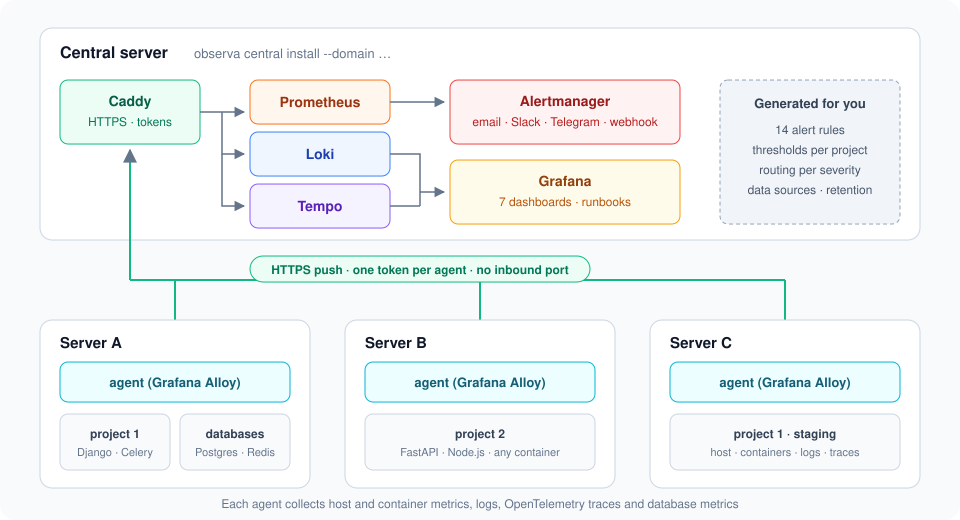

# ObservaBoard

[](https://github.com/root-lr/observaboard/actions/workflows/ci.yml)
[](https://github.com/root-lr/observaboard/releases)
[](LICENSE)
[](go.mod)

**Monitoring for your Docker applications in one command.** ObservaBoard installs and configures Grafana, Prometheus, Loki, Tempo and Alertmanager, detects each project's stack (Django, FastAPI, Celery, PostgreSQL, Redis…), instruments it without touching the code, and generates matching dashboards, alerts and runbooks.

```text
observa central install --domain observa.example.com     # the brain: storage, dashboards, alerts
observa agent install --central … --token …              # one agent per server to monitor
observa init && observa apply                             # in each project: detection + configuration
```

Self-hosted, Docker-native (Compose or `docker run`), multi-project and multi-server. MIT license.

---

## Try it in 5 minutes (Mac, Windows or Linux)

Requirements: Docker (Docker Desktop on Mac/Windows).

Install the CLI from the [releases](https://github.com/root-lr/observaboard/releases) (Linux and macOS, amd64 and arm64; checksums verified):

```bash
curl -fsSL https://raw.githubusercontent.com/root-lr/observaboard/main/install.sh | sh
observa up --all-in-one --with-example
```

Or build it from source (Go 1.24+):

```bash
git clone https://github.com/root-lr/observaboard && cd observaboard
make build
bin/observa up --all-in-one --with-example
```

This command starts, on your machine:

- the **central** (Grafana at http://localhost:3000, credentials printed);
- the **agent**;
- an **example Django shop** (PostgreSQL, Redis, Celery worker) with a traffic generator.

After one or two minutes, the Grafana *Overview* fills up. Then trigger a failure and watch the alert fire:

```bash
docker compose --project-directory ~/.observa/local/example exec web python manage.py chaos errors
#   other failures: latency · dependency · tasks · status · reset
```

To stop: `observa down --all-in-one` (add `--volumes` to delete the data).

---

## Deploying for real



### 1. The central

On a dedicated server (2 vCPU, 4 GB RAM, 50 GB disk for the default retention periods) whose domain name points to its IP:

```bash
sudo observa central install --domain observa.example.com --email you@example.com
```

The command prints the Grafana password and the first agent's token. Both are shown only once. The HTTPS certificate is obtained automatically (Let's Encrypt).

Without a domain name, use `--ip <address>`: Caddy then issues an internal certificate. Fetch its authority with `observa central ca > central-ca.crt`, then pass that file to the agents with `--ca-file`.

Configure notifications in `/opt/observa/central/central.yaml` (email, Slack, Telegram, webhook; see [docs/central-yaml.md](docs/central-yaml.md)), then:

```bash
sudo observa central reload
sudo observa alert test          # checks that a notification arrives
```

### 2. One agent per server

```bash
# on the central: one token per server
sudo observa token create srv-a

# on server srv-a (the token is read from a file so it does not stay in the shell history)
sudo observa agent install --central https://observa.example.com --token-file token.txt
```

The agent is a single Grafana Alloy container. It **pushes** its data to the central: no port to open on your servers. It immediately monitors the host and every container carrying the `observa.enable=true` label.

### 3. Each project

In the project's repository (on your machine or on the server):

```bash
observa init
```

`init` reads `docker-compose.yml` and the dependencies (`requirements.txt`, `pyproject.toml`, `package.json`, Dockerfile), suggests a preset per service, then generates:

| File | Purpose |
| --- | --- |
| `observa.yaml` | Project description: services, presets, alert thresholds, notification channels. Commit it. |
| `docker-compose.observa.yml` | Compose override: labels, `observa` network, OpenTelemetry variables, instrumented command. The original compose file is never modified. |
| `Dockerfile.observa` | Derived image that adds the OpenTelemetry SDK (Python or Node.js). |

Then, on the server:

```bash
observa apply                                                          # thresholds, routing, databases
docker compose -f docker-compose.yml -f docker-compose.observa.yml up -d --build
observa doctor                                                         # is everything arriving?
```

`observa init` prints the exact command for your project. If a `docker-compose.override.yml` exists, it includes it, because Compose ignores it as soon as `-f` is passed.

`init` handles the common cases:
- `ENTRYPOINT` (that is what gets instrumented);
- multi-stage Dockerfiles with `build.target`;
- `network_mode: host` services (monitored without the `observa` network);
- Dockerfile `$` variables.

Containers started without Compose: `observa init --runtime docker --service api=django --service db=postgres`. A container already running, without restarting it: `observa attach <container> --project p --preset generic`.

---

## What gets monitored

| Level | What you do | What you get |
| --- | --- | --- |
| **1 · no app changes** | nothing (`observa.enable` label) | centralized logs, CPU/memory/network/restarts, availability, host metrics |
| **1 · eBPF** (`--ebpf` option, Linux) | declare `instrumentation: ebpf` and the port | HTTP traces and HTTP metrics, whatever the language |
| **2 · modified startup** | apply the generated override | detailed traces (views, SQL, outgoing calls, Redis, Celery), HTTP metrics per route |
| **3 · code** | add your business metrics (OpenTelemetry SDK) | business indicators (guide in V2) |

| Preset | Detected by | Dashboard | Default alerts (adjustable thresholds) |
| --- | --- | --- | --- |
| `django` | `django` dependency, `gunicorn`/`manage.py` | HTTP service | 5xx > 5% · p95 > 1 s · service down |
| `fastapi` | `fastapi`/`starlette` dependency | HTTP service | 5xx > 5% · p95 > 1 s · service down |
| `celery` | `celery … worker` command | Celery worker | failed tasks > 10% · service down |
| `postgres` | `postgres`, `postgis`, `timescale` image | PostgreSQL | unreachable · connections > 80% |
| `redis` | `redis`, `valkey` image | Redis | unreachable · memory > 90% · Celery queue > 100 |
| `generic` | everything else (Node.js instrumented automatically) | Service · container | down · restart loop · 5xx · p95 |

Always on: silent agent, disk > 85%, memory > 90%, central component failure, Watchdog (optional external heartbeat). Every alert links to a **runbook** (served at `/runbooks/`) and to the diagnostic dashboard.

Languages: every container is covered at level 1. Level 2 covers **Python** and **Node.js** in V1, then Java, PHP, .NET and Ruby in V2. Details in [docs/presets.md](docs/presets.md).

---

## Commands

| Command | Where | Purpose |
| --- | --- | --- |
| `observa up --all-in-one [--with-example]` | workstation, single server | central + agent on the same machine |
| `observa down --all-in-one [--volumes]` | same | stop everything |
| `observa central install --domain …` · `reload` · `upgrade` · `status` · `ca` | central | install and manage the central |
| `observa token create\|list\|revoke <agent>` | central | manage agent tokens |
| `observa agent install --central … --token-file …` · `reload` · `status` | server | install and manage the agent (`--token`, `--token-file`, or `OBSERVA_AGENT_TOKEN`) |
| `observa agent env set NAME=value` | server | agent secrets (PostgreSQL, Redis access) |
| `observa init` | project | detect the stack, generate `observa.yaml` and the override |
| `observa validate` | project, CI | validate `observa.yaml` |
| `observa apply [--remove]` | server | register the project with the agent |
| `observa attach <container>` · `detach` | server | monitor an existing container without labels |
| `observa preset list\|show <name>` | anywhere | available presets |
| `observa doctor` | anywhere | diagnose agent, central and project |
| `observa alert test` | central | send a test alert |

Global `--dry-run` option: prints the Docker commands instead of running them.

---

## Documentation

- [Architecture and data flow](docs/architecture.md)
- [observa.yaml reference](docs/observa-yaml.md) · [central.yaml reference](docs/central-yaml.md)
- [Presets and languages](docs/presets.md)
- [Security](docs/security.md)
- [Mac and Windows](docs/mac-windows.md)
- [Development: layout, tests, versions](docs/development.md)
- [V2 roadmap](docs/v2.md)

## Known limitations (V1)

- **Sampling rate:** HTTP metrics are computed from traces, so sampling must be 100%. That is the default setting, suited to low and medium traffic.
- **Dashboards:** they are shared across projects, with a project/env/service filter. Per-project folders come in V2.
- **Agent:** it runs as a privileged container (a cAdvisor requirement) and reads the Docker socket. Services from all projects on a server share the `observa` network. See [docs/security.md](docs/security.md).
- **eBPF:** it requires Linux kernel 5.8+. It is not guaranteed under Docker Desktop.
- **Celery:** only the `celery` queue (database 0) is monitored.
- **Not covered:** Kubernetes, serverless and mobile ([PRD](docs/v2.md)).

## License

ObservaBoard is released under the [MIT license](LICENSE).

The components it deploys keep their own licenses. They are pulled unmodified from their official images, and ObservaBoard does not redistribute them:

| Component | License |
| --- | --- |
| Grafana, Loki, Tempo | AGPL-3.0 |
| Prometheus, Alertmanager, Caddy, Grafana Alloy | Apache-2.0 |
| OpenTelemetry SDKs (added to your images by `Dockerfile.observa`) | Apache-2.0 |
| Vendored Go code in `internal/thirdparty/` (yaml.v3, bcrypt, blowfish) | MIT and Apache-2.0, BSD-3-Clause |

Details, versions, the example shop's dependencies and a note on what the AGPL means here: [THIRD_PARTY_LICENSES.md](THIRD_PARTY_LICENSES.md).
